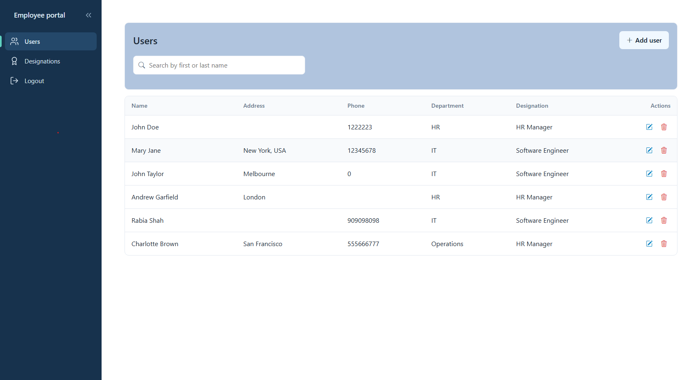

# Employee Portal

A full-stack employee management portal built with **ASP.NET Core (.NET 10)**, **Angular 22** and **Microsoft SQL Server**. It features JWT authentication, role-based access control using claims, a reactive Angular front end built on Signals and RxJS, and unit tests on the front end.




---

## Table of Contents

- [Features](#features)
- [Tech Stack](#tech-stack)
- [Architecture](#architecture)
- [Authentication and Authorization](#authentication-and-authorization)
- [Getting Started](#getting-started)
- [Running the Tests](#running-the-tests)
- [Project Structure](#project-structure)
- [AI-Assisted Development](#ai-assisted-development)
- [Author](#author)

---

## Features

- **Secure login and logout**, with a sign-in page that has a show/hide password toggle and a Remember me option, and client-side session handling using `sessionStorage` and `localStorage`
- **JWT authentication** issued by the API and attached to requests from the Angular client
- **Role-based access control** enforced with JWT claims, both in the API and in the UI
- **Protected routes:** unauthenticated visitors are redirected to the login page, and after a successful login the user lands on the dashboard
- **Admin module access:** admins can add, edit, delete and view users in the Users module, and designations in the Designations module
- **User management tools:** search users by first or last name, assign a department and designation from dropdowns, and confirm before deleting a user
- **Self-service profile:** non-admin users can view their own profile and edit their phone number and address. Name, department and designation are read-only
- **Reactive Angular UI** using Signals for state and RxJS Observables for HTTP calls
- **Collapsible sidebar navigation** with route-based active states
- **Unit tests** using Vitest and Jasmine

## Tech Stack

| Layer | Technology |
| --- | --- |
| Backend | C#, ASP.NET Core Web API (.NET 10) |
| Frontend | Angular 22, TypeScript, Signals, RxJS |
| Database | Microsoft SQL Server (`MasterDB`, tables and stored procedures) |
| Auth | JWT bearer tokens, claims-based authorization |
| Testing | Vitest, Jasmine |
| Tooling | Git, GitHub, GitHub Copilot |

## Architecture

```
┌──────────────┐   HTTPS + JWT   ┌────────────────────┐    ┌──────────────┐
│  Angular 22  │ ──────────────▶ │ ASP.NET Core API   │ ─▶ │  SQL Server  │
│  (Signals,   │ ◀────────────── │ (.NET 10)          │ ◀─ │              │
│   RxJS)      │      JSON       │ JWT + claims       │    │              │
└──────────────┘                 └────────────────────┘    └──────────────┘
```

The Angular client calls the REST API through services that return RxJS Observables. UI state is managed with Signals. The API validates the JWT on each request and authorizes access using the claims in the token.

## Authentication and Authorization

1. A user signs in with their credentials, and the API returns a signed **JWT** containing the user's identity and role **claims**.
2. The client stores the session data using `sessionStorage` and `localStorage` and sends the token with each API request.
3. A route guard checks for a valid session. If the user is **not logged in**, they are redirected to the login page. After a successful login they are taken to the **dashboard**.
4. The API checks the token and the user's claims before allowing access to protected endpoints.
5. The Angular app uses the same role information to guard routes and show or hide UI elements.
6. On **logout**, the stored session data is cleared and the user is returned to the login page.

### Roles and permissions

| Role | Access |
| --- | --- |
| **Admin** | Full access: add, edit, delete and view **users** (Users module) and **designations** (Designations module) |
| **User** | Can log in and view their own profile only, and edit their own phone number and address |

## Getting Started

### Prerequisites

- [Visual Studio](https://visualstudio.microsoft.com/) (a recent version that supports .NET 10) with the **ASP.NET and web development** workload
- [.NET 10 SDK](https://dotnet.microsoft.com/download) (included with a compatible Visual Studio; the solution uses the `.slnx` format)
- [Node.js](https://nodejs.org/) (a version supported by Angular 22) and npm
- Microsoft SQL Server (local instance, Docker or LocalDB)

### 1. Clone the repository

```bash
git clone https://github.com/RabiaShah/Employee-Portal.git
cd Employee-Portal
```

### 2. Configure the API

1. Open `EmployeeApp/appsettings.json` (or `appsettings.Development.json`) and set your database connection string and JWT settings:

   ```json
   {
     "ConnectionStrings": {
       "DefaultConnection": "Server=[server];Database=MasterDB;Trusted_Connection=True;TrustServerCertificate=True"
     },
     "Jwt": {
       "Key": "[a long, random secret, do not commit a real one]",
       "Issuer": "[issuer]",
       "Audience": "[audience]"
     }
   }
   ```

### 3. Set up the database

The repository includes a SQL script, `CreateMasterDBTables.sql` [add its folder path, e.g. `EmployeeApp/Database/`], which sets up everything the application needs in a database named **MasterDB**:

- all the required **tables**
- the **stored procedures** used by the API
- the **initial data** the project needs to run

To run it:

1. Make sure SQL Server is running, and create an empty database named `MasterDB` (skip this if the script creates it for you).
2. Open `CreateMasterDBTables.sql` in SQL Server Management Studio, Azure Data Studio or Visual Studio (SQL Server Object Explorer), and make sure `MasterDB` is the selected database.
3. Execute the script.

Or from the command line:

```bash
sqlcmd -S [server] -d MasterDB -i CreateMasterDBTables.sql
```

Check that the `DefaultConnection` string in `appsettings.json` points to your SQL Server instance and the `MasterDB` database.

### 4. Run the application

1. Open `EmployeeApp.slnx` in Visual Studio.
2. Click **Start** (or press `F5`).

The solution is set up with **multiple startup projects**, so the ASP.NET Core API and the Angular app both start together. There is no need to run `ng serve` separately. The Angular app runs at `http://localhost:51865`.

If the Angular dependencies are missing on the first run, open a terminal in `EmployeeAngularApp` and run `npm install`.

> If Visual Studio starts only one project, right-click the solution, choose **Configure Startup Projects**, select **Multiple startup projects**, and set both projects to **Start**.

### Default login

Demo accounts are available for **local development and demo purposes only**:

| Role | Username | Password |
| --- | --- | --- |
| Admin | `admin` | `1234` |
| User | `john doe` | `1234` |

Log in as **admin** to manage users and designations, or as **john doe** to see the standard user experience (own profile only).

> **Security note:** these credentials are for local testing. Change the passwords (and remove or disable the demo accounts) before deploying the application anywhere public.

## Running the Tests

**Frontend**

```bash
cd EmployeeAngularApp
ng test
```

The Angular unit tests use Vitest and Jasmine. [Add a short note on what is covered, e.g. services, guards, components, signals.]

**Backend** [add if applicable]

```bash
dotnet test
```

## Project Structure

```
Employee-Portal/
├── .github/                # GitHub configuration
├── EmployeeApp/            # ASP.NET Core Web API (.NET 10)
│   ├── Controllers/
│   ├── Models/
│   ├── Services/
│   └── ...
├── EmployeeAngularApp/     # Angular 22 client
│   └── src/app/
│       ├── core/           # auth service, guards, interceptors
│       ├── features/       # login, dashboard, users, designations, profile
│       └── shared/         # sidebar, common components
├── FirstProject/           # [describe what this is, or remove it from the repo]
├── EmployeeApp.slnx        # .NET solution file
├── NuGet.Config
└── README.md
```

> The top-level folders match the repository. Update the sub-folders inside each project to match your actual structure.

## AI-Assisted Development

This project was built with the help of **GitHub Copilot** in Visual Studio for boilerplate, test scaffolding and code suggestions. All generated code was reviewed, tested and adapted before being committed.

## Author

**Syeda Rabia Arshad**
[LinkedIn](https://linkedin.com/in/syedarabiaarshad) · [GitHub](https://github.com/RabiaShah)
